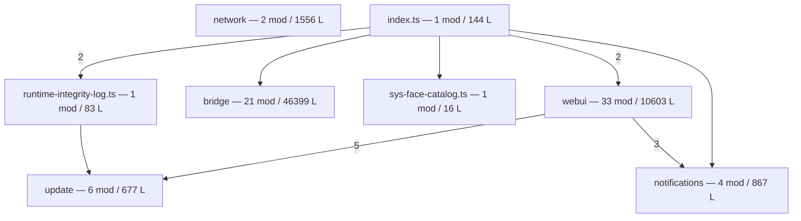
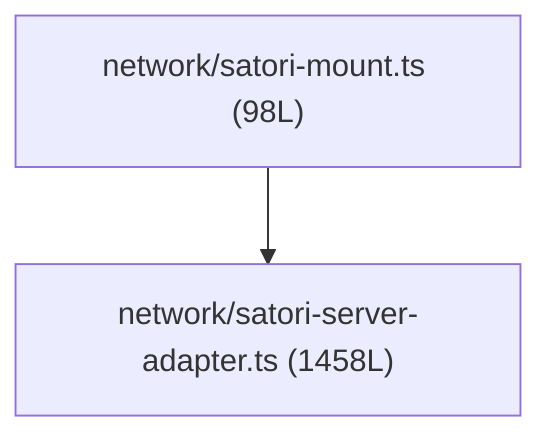
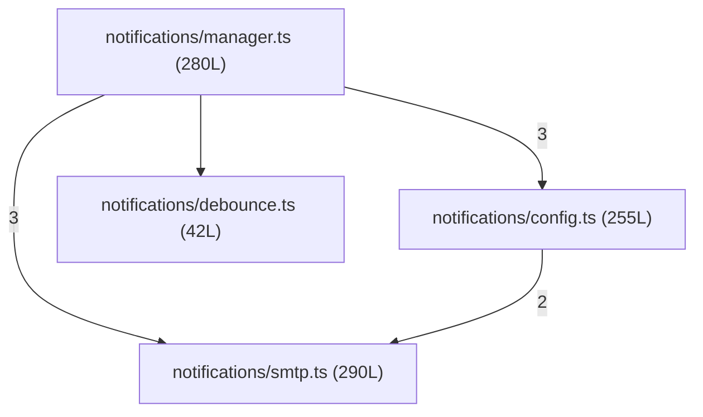
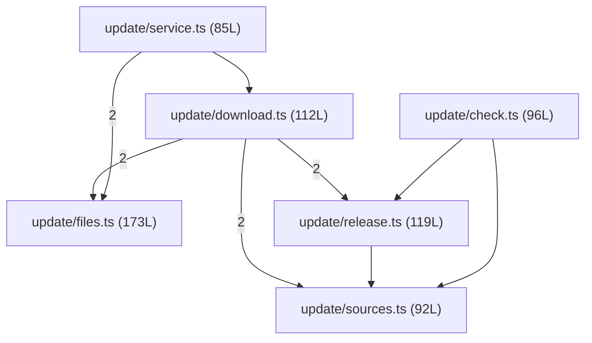

# The `src/*` layer — real sizes, module boundaries, dependency graph

Status as of 2026-11-22. Every number below is the output of a script kept in
`work/`; nothing here is estimated, remembered, or inferred from a bundle-wide
grep. Reproduce with:

```bash
cd /home/ubuntu/hook-rewrite
node work/src-region-scan.mjs   > /home/ubuntu/src-regions.json  # region table + graph
node work/src-layer-report.mjs  /home/ubuntu/src-regions.json    # §2–§5, §7 tables
node work/src-layer-mermaid.mjs /home/ubuntu/src-regions.json    # §6 graph
node work/src-capability-probe.mjs                               # §7 "have we got it" table
node work/bridge-deps.mjs                                        # the pre-existing bridge view
```

(The scan's JSON output path is deliberately outside the repo: it is a 138 KB
intermediate with no reason to be committed, and `/tmp` is tmpfs on this box.)

The scan streams the bundle through `readline` and peaks at **~100 MB RSS**
(`/usr/bin/time -v`, recorded below), because this box has 1.9 GB and `/tmp` is tmpfs.
One pass over 13.9 MB takes 0.7 s.

---

## 0. What this document does NOT prove

Read this before quoting any figure from it.

1. **Line and byte counts are static text measurements.** A region's span is
   measured from its `//#region` banner through its closing `//#endregion`; both
   marker lines count. That convention was chosen because `docs/bridge-layer.md`
   used it for its 46,399-line figure, so the numbers here are directly comparable
   to that document. Body-only figures are one line per region lower (bridge: 21).
   **Nothing about runtime size, reachability, or whether the code ever executes.**
   472 regions are in the bundle; a region can be 100% dead code and still counts.

2. **No line count here implies "portable in that many lines".** The three largest
   modules are mostly *generated*: protobuf codecs (`message.ts`, `group-album.ts`)
   and a gzipped Markdown corpus (`docs-corpus.ts`, 43.6% of the layer's bytes in
   3,582 lines). `docs/bridge-layer.md` §2.6 measured `message.ts`'s 11,082 lines as
   ~10,420 lines of generated codec. This document reports the generated code and
   the hand-written code in the same column because they are the same bytes; it does
   not pretend they cost the same to port.

3. **"Export" is reconstructed, not read.** The bundle contains **zero `export`
   statements** (verified: `grep -c '^export ' reference/index.mjs` → 0) because
   rollup inlined every module into one flat scope. A declaration is treated as
   public when some *other* region mentions it. This is a lower bound (an exported
   symbol nobody uses is invisible) and it cannot distinguish a genuine export from
   an incidentally-global name. §8's ordering depends on it.

4. **The dependency graph is text-derived.** Edges come from bare-identifier
   references after comment/string/regex masking (§6.1 records the three rounds of
   masking bugs that had to be fixed first). It cannot see dynamic access
   (`ctx[key]`), prototype patching, or a call made through an object property. It
   reports **92 intra-`src` edges**; the true number is probably slightly higher,
   never lower. Cross-check: all 145 symbols backing those 92 edges were
   independently verified to appear on a non-comment line of the source region.

5. **"We already have it" in §7 means a code artefact exists**, i.e. a symbol matched
   outside comments and string literals. It does **not** mean the capability works
   against a real QQ. `PROGRESS.md` §3 is the authority on that, and it says the one
   end-to-end send is still unproven.

6. **Nothing here was run against QQ, Docker, or a built payload.** This is pure
   static analysis of `reference/index.mjs` plus `git`-clean inspection of `ts/src`.

---

## 1. The headline number is wrong, and the reason matters

`PROGRESS.md` (lines 46, 528, 668) and `MEMORY.md` (line 4215) all say **`src/*` is
2.26 MB / 18%**. Against the file in this repo it is **3.32 MB / 23.85%**.

Both numbers are correct — for different files. The figure was measured on
`/sdcard/snowluma-work/index.mjs` (12,868,403 B, 472 regions), not on
`reference/index.mjs` (13,916,690 B, 472 regions). Of the 472 region *names*, only
two regions differ in size between the two bundles:

| region | snowluma-work | reference | delta |
| --- | ---: | ---: | ---: |
| `src/webui/docs-corpus.ts` | 1,036 L / 412,292 B | 3,582 L / 1,445,600 B | **+1,033,308 B** |
| `src/webui/docs-mount.ts` | 1,297 L / 49,312 B | 1,383 L / 56,777 B | +7,465 B |
| everything else (470 regions) | — | — | **byte-identical** |

So the delta is one generated documentation corpus growing from 1,036 to 3,582 lines,
not a code change. The *logic* of the layer did not change at all between the two
files.

Three consequences follow, and they pull in opposite directions:

- The `2.26 MB` figure **understates** the layer as it exists in
  `reference/index.mjs` (3.32 MB), because the corpus doubled.
- The `18%` weights in `PROGRESS.md`/`MEMORY.md` also **understate** the layer's share
  of the reference (23.85%), for the same reason.
- But the reference's 3.32 MB/23.85% is itself **inflated** by one data blob: strip the
  three generated regions and the layer is 1.81 MB/13.0%; strip also the five
  local-only regions and it is 1.75 MB/12.6%.

So the framing that survives all three:

| quantity | lines | bytes | % of bundle bytes |
| --- | ---: | ---: | ---: |
| `src/*` as it exists in `reference/index.mjs` | 60,345 | 3,318,971 | 23.85% |
| minus the three generated regions¹ | 55,171 | 1,808,604 | 13.00% |
| minus the five regions that exist only in the local bundles² | 53,615 | 1,748,339 | 12.56% |

¹ `docs-corpus.ts`, `docs-mount.ts`, `cache-headers.ts` — each carries a
`GENERATED FILE` / `@ts-nocheck` banner.
² The five regions absent from the pristine 467-region bundle:
`src/network/satori-server-adapter.ts`, `src/network/satori-mount.ts`,
`src/webui/docs-corpus.ts`, `src/webui/docs-mount.ts`, `src/webui/cache-headers.ts`.
Verified by diffing region *names* against
`/sdcard/snowluma-restore/restored/dist/index.mjs` (12,338,351 B, 467 regions,
`src/*` = 1.75 MB / 14.17%).

**Which number to use depends on the question.** For "how much SnowLuma code is left
to rewrite", the answer is the last row: **~1.75 MB, ~12.6% of the bundle**. For "how
many bytes of `src/*` must I read to understand the layer", it is 3.32 MB, because the
corpus is in the way. `PROGRESS.md`'s 2.26 MB is neither: it is the reference's logic
plus an *older, smaller* copy of the corpus, measured against a 12.87 MB bundle that is
not the one in this repo.

---

## 2. Real sizes

### 2.1 Totals

| | lines | bytes | % of bundle lines | % of bundle bytes |
| --- | ---: | ---: | ---: | ---: |
| whole bundle | 374326 | 13916690 | 100% | 100% |
| `src/*` (all 69 regions) | 60345 | 3318971 | 16.12% | 23.85% |

### 2.2 Per subtree

`src/bridge` is 76.9% of the layer's lines; `src/webui` is 51.0% of its bytes (the
docs corpus alone is 1.45 MB of that 1.69 MB, i.e. 86% of the subtree's bytes). Both
statements are true and neither is the interesting one on its own.

| subtree | modules | lines | bytes | % of `src/*` lines |
| --- | ---: | ---: | ---: | ---: |
| `src/bridge` | 21 | 46399 | 1506786 | 76.9% |
| `src/webui` | 33 | 10603 | 1691839 | 17.6% |
| `src/network` | 2 | 1556 | 60265 | 2.6% |
| `src/notifications` | 4 | 867 | 27634 | 1.4% |
| `src/update` | 6 | 677 | 24116 | 1.1% |
| `src/index.ts` | 1 | 144 | 4823 | 0.2% |
| `src/runtime-integrity-log.ts` | 1 | 83 | 2723 | 0.1% |
| `src/sys-face-catalog.ts` | 1 | 16 | 785 | 0.0% |

---

## 3. Every module, with its dependency counts

Columns: *referenced elsewhere* = size of the reconstructed public surface (§0.3);
*src deps out/in* = intra-`src` edges from §6; *lower layers* = which non-`src`
regions the module references names from, with a count. `..` is vendor code
(`node_modules`, mostly hono and zxcvbn).

| module | lines | bytes | top-level decls | referenced elsewhere | src deps out | src deps in | lower layers (name count) | capabilities |
| --- | ---: | ---: | ---: | ---: | ---: | ---: | --- | --- |
| `src/bridge/apis/forward.ts` | 17593 | 553103 | 163 | 1 | 1 | 1 | protocol(7), common(2) | rawPacket 2 |
| `src/bridge/apis/message.ts` | 11082 | 360041 | 142 | 1 | 1 | 1 | protocol(9), onebot(2), common(1) | OIDB 1, rawPacket 8, highway 1 |
| `src/bridge/apis/group-album.ts` | 9288 | 302359 | 151 | 1 | 0 | 1 | protocol(2), common(1), bridge(1) | rawPacket 6, cookie 2 |
| `src/webui/docs-corpus.ts` | 3582 | 1445600 | 1 | 1 | 0 | 1 | — | — |
| `src/bridge/apis/flash-transfer.ts` | 1692 | 56534 | 55 | 1 | 0 | 1 | protocol(7) | OIDB 13 |
| `src/webui/server.ts` | 1591 | 52289 | 29 | 2 | 30 | 2 | common(15), onebot(10), ..(2), bridge(2) | nativeHook 9, spawn 2 |
| `src/bridge/apis/group-file.ts` | 1539 | 49419 | 39 | 1 | 0 | 1 | protocol(8), common(1) | OIDB 19 (1 missing), highway 4 |
| `src/network/satori-server-adapter.ts` | 1458 | 56040 | 83 | 1 | 0 | 1 | onebot(12), websocket(2), common(1) | httpServer 2 |
| `src/bridge/apis/extras.ts` | 1422 | 47777 | 37 | 1 | 0 | 1 | protocol(2), common(1) | OIDB 5, rawPacket 1 |
| `src/webui/docs-mount.ts` | 1383 | 56777 | 64 | 0 | 4 | 0 | ..(2), common(1) | — |
| `src/bridge/apis/profile.ts` | 986 | 32389 | 31 | 1 | 0 | 1 | protocol(5) | OIDB 12 (4 missing), rawPacket 1, highway 6 |
| `src/bridge/apis/misc.ts` | 789 | 26683 | 25 | 1 | 0 | 1 | protocol(1) | OIDB 5, rawPacket 1 |
| `src/webui/ui-config.ts` | 621 | 18405 | 52 | 10 | 0 | 2 | common(5) | — |
| `src/webui/backup.ts` | 460 | 16562 | 26 | 3 | 5 | 2 | common(2), onebot(2) | — |
| `src/bridge/apis/contacts.ts` | 386 | 16721 | 8 | 1 | 0 | 1 | protocol(4), common(3) | OIDB 15 |
| `src/bridge/bridge.ts` | 371 | 13273 | 4 | 1 | 1 | 1 | protocol(9), common(4), bridge(1) | rawPacket 1 |
| `src/webui/restore.ts` | 296 | 10441 | 7 | 2 | 1 | 1 | common(2) | — |
| `src/webui/auth.ts` | 292 | 9576 | 21 | 4 | 1 | 2 | common(1) | crypto 2 |
| `src/notifications/smtp.ts` | 290 | 9341 | 21 | 4 | 0 | 2 | — | tls 2 |
| `src/notifications/manager.ts` | 280 | 8267 | 9 | 1 | 3 | 1 | common(3), onebot(1) | nativeHook 1 |
| `src/bridge/apis/group-admin.ts` | 274 | 9654 | 3 | 1 | 0 | 1 | protocol(8), common(1) | OIDB 27 (8 missing) |
| `src/notifications/config.ts` | 255 | 8893 | 40 | 5 | 1 | 3 | common(6) | — |
| `src/bridge/manager.ts` | 249 | 10200 | 4 | 1 | 1 | 1 | common(4), protocol(1) | — |
| `src/webui/totp.ts` | 242 | 8467 | 32 | 7 | 0 | 3 | — | crypto 3 |
| `src/bridge/apis/web.ts` | 232 | 10285 | 11 | 1 | 0 | 1 | protocol(13) | OIDB 2, cookie 36 |
| `src/webui/storage-routes.ts` | 228 | 7423 | 8 | 1 | 2 | 1 | common(2) | — |
| `src/webui/storage-management.ts` | 220 | 6639 | 12 | 4 | 0 | 3 | common(2), onebot(1) | — |
| `src/webui/cache-headers.ts` | 209 | 7990 | 4 | 0 | 1 | 0 | — | — |
| `src/webui/mutation-trace.ts` | 182 | 7843 | 15 | 2 | 0 | 2 | common(7) | — |
| `src/webui/storage-settings.ts` | 177 | 6837 | 14 | 4 | 1 | 2 | common(1) | — |
| `src/update/files.ts` | 173 | 6166 | 12 | 6 | 0 | 3 | common(1) | — |
| `src/bridge/apis/qzone.ts` | 158 | 7823 | 1 | 1 | 0 | 1 | protocol(30) | cookie 30 |
| `src/webui/consent.ts` | 157 | 5690 | 21 | 8 | 0 | 1 | common(1) | — |
| `src/index.ts` | 144 | 4823 | 5 | 1 | 6 | 0 | onebot(5), common(4), bridge(2) | nativeHook 5 |
| `src/webui/debug-tools.ts` | 124 | 4871 | 9 | 2 | 2 | 1 | — | — |
| `src/update/release.ts` | 119 | 4627 | 6 | 2 | 1 | 2 | common(1) | — |
| `src/update/download.ts` | 112 | 4935 | 3 | 1 | 3 | 1 | ..(1) | — |
| `src/network/satori-mount.ts` | 98 | 4225 | 6 | 0 | 1 | 0 | common(1), onebot(1) | — |
| `src/update/check.ts` | 96 | 2899 | 9 | 1 | 2 | 1 | common(5) | — |
| `src/update/sources.ts` | 92 | 2981 | 6 | 5 | 0 | 4 | common(4) | — |
| `src/update/service.ts` | 85 | 2508 | 2 | 1 | 2 | 1 | common(2) | — |
| `src/bridge/apis/friend.ts` | 83 | 2886 | 2 | 1 | 0 | 1 | common(1), onebot(1) | OIDB 7 |
| `src/runtime-integrity-log.ts` | 83 | 2723 | 5 | 3 | 1 | 1 | common(1), bridge(1) | spawn 1 |
| `src/webui/connection-diff-loop.ts` | 78 | 2643 | 2 | 1 | 0 | 1 | common(3) | — |
| `src/webui/state-stream.ts` | 77 | 1743 | 3 | 1 | 0 | 1 | common(2) | — |
| `src/bridge/apis/history-request-gate.ts` | 72 | 2746 | 5 | 1 | 0 | 1 | — | — |
| `src/webui/sse-response.ts` | 71 | 1892 | 2 | 1 | 0 | 2 | common(1) | — |
| `src/webui/update-routes.ts` | 67 | 1962 | 1 | 1 | 1 | 1 | ..(1), common(1) | — |
| `src/webui/system-settings.ts` | 66 | 1767 | 4 | 3 | 1 | 1 | common(1) | — |
| `src/bridge/apis/interaction.ts` | 65 | 1222 | 1 | 1 | 0 | 1 | — | OIDB 6 |
| `src/webui/tls.ts` | 65 | 1648 | 3 | 3 | 0 | 2 | common(1) | — |
| `src/webui/client-ip.ts` | 59 | 2203 | 6 | 4 | 0 | 2 | ..(1) | — |
| `src/webui/request-security.ts` | 58 | 2080 | 11 | 6 | 0 | 2 | ..(4) | — |
| `src/webui/onebot-token-policy.ts` | 47 | 2228 | 5 | 2 | 1 | 1 | ..(1) | — |
| `src/notifications/debounce.ts` | 42 | 1133 | 1 | 1 | 0 | 1 | — | — |
| `src/bridge/apis/forward-cache.ts` | 39 | 1228 | 3 | 1 | 0 | 1 | common(1) | — |
| `src/webui/state-bus.ts` | 38 | 1243 | 2 | 1 | 0 | 1 | common(1) | — |
| `src/webui/port.ts` | 38 | 1038 | 2 | 1 | 0 | 1 | — | httpServer 2 |
| `src/webui/log-export.ts` | 36 | 1367 | 3 | 1 | 0 | 1 | — | — |
| `src/bridge/apis/index.ts` | 30 | 1005 | 1 | 1 | 16 | 1 | — | — |
| `src/webui/webui-login.ts` | 29 | 1064 | 3 | 2 | 1 | 1 | — | — |
| `src/bridge/apis/system-face.ts` | 28 | 827 | 1 | 1 | 0 | 1 | protocol(2) | — |
| `src/webui/connection-snapshot.ts` | 24 | 873 | 1 | 1 | 0 | 1 | — | — |
| `src/webui/static-frontend.ts` | 22 | 837 | 1 | 1 | 0 | 3 | common(1), ..(1) | — |
| `src/webui/debug-stream.ts` | 22 | 587 | 1 | 1 | 0 | 1 | — | — |
| `src/bridge/apis/collection.ts` | 21 | 611 | 2 | 1 | 0 | 1 | protocol(1) | OIDB 1, cookie 1 |
| `src/webui/state-wiring.ts` | 21 | 474 | 1 | 1 | 1 | 1 | — | — |
| `src/webui/listener-exposure.ts` | 21 | 780 | 2 | 2 | 0 | 3 | — | — |
| `src/sys-face-catalog.ts` | 16 | 785 | 2 | 1 | 0 | 1 | protocol(2), common(1) | — |

---

## 4. Exported symbols per module

Names in **bold** are referenced by more than one other region (the count is in
parentheses). Single-reference names are plain. Local `log$N` bindings and
module-private constants are included only when something else touches them, which
is why several one-function modules show exactly one name.

- `src/bridge/apis/forward.ts` (17593 L) — ForwardApi
- `src/bridge/apis/message.ts` (11082 L) — MessageApi
- `src/bridge/apis/group-album.ts` (9288 L) — GroupAlbumApi
- `src/webui/docs-corpus.ts` (3582 L) — hzDocsCorpusGzipB64
- `src/bridge/apis/flash-transfer.ts` (1692 L) — FlashTransferApi
- `src/webui/server.ts` (1591 L) — initWebUI, sessionTokens
- `src/bridge/apis/group-file.ts` (1539 L) — GroupFileApi
- `src/network/satori-server-adapter.ts` (1458 L) — SatoriServerAdapter
- `src/bridge/apis/extras.ts` (1422 L) — ExtrasApi
- `src/bridge/apis/profile.ts` (986 L) — ProfileApi
- `src/bridge/apis/misc.ts` (789 L) — MiscApi
- `src/webui/ui-config.ts` (621 L) — **cached**(3), **sniffImageMime**(2), clearBackgroundImage, loadUiConfig, MAX_BACKGROUND_BYTES, normalizeStoredUiConfig, publicAppearance, readBackgroundImage, saveUiConfig, writeBackgroundImage
- `src/webui/backup.ts` (460 L) — buildBackup, prepareRestorePlan, RestorePreflightError
- `src/bridge/apis/contacts.ts` (386 L) — ContactsApi
- `src/bridge/bridge.ts` (371 L) — Bridge
- `src/webui/restore.ts` (296 L) — restoreBackup, RestoreTransactionError
- `src/webui/auth.ts` (292 L) — evaluatePasswordRules, isStrongPassword, prepareWebuiAuthStateForRestore, WebuiAuth
- `src/notifications/smtp.ts` (290 L) — **parseRecipients**(2), extractAddress, formatSmtpError, sendSmtpMail
- `src/notifications/manager.ts` (280 L) — createNotificationManager
- `src/bridge/apis/group-admin.ts` (274 L) — GroupAdminApi
- `src/notifications/config.ts` (255 L) — **loadNotificationsConfig**(2), isEmailChannel, normalizeNotificationsConfig, renderTemplate, saveNotificationsConfig
- `src/bridge/manager.ts` (249 L) — BridgeManager
- `src/webui/totp.ts` (242 L) — **decideSecondFactorLogin**(2), beginTotpEnrollment, confirmTotpEnrollment, parseTotpStateLenient, prepareTotpStateForRestore, regenerateRecoveryCodes, rewrapTotpSecret
- `src/bridge/apis/web.ts` (232 L) — WebApi
- `src/webui/storage-routes.ts` (228 L) — registerStorageRoutes
- `src/webui/storage-management.ts` (220 L) — publicLogStorageStatus, StorageAccountOnlineError, StorageManagementInputError, StorageManagementService
- `src/webui/mutation-trace.ts` (182 L) — traceAuthenticatedWebuiMutation, traceWebuiMutationRequestChunk
- `src/webui/storage-settings.ts` (177 L) — LogStorageSettingsManager, StorageSettingsInputError, StorageSettingsLockedError, StorageSettingsTransactionError
- `src/update/files.ts` (173 L) — **readManifest**(2), applyPendingUpdate, exists, isRuntimeEntry, restore, updateDirectory
- `src/bridge/apis/qzone.ts` (158 L) — QzoneApi
- `src/webui/consent.ts` (157 L) — cache, EULA_ACCEPT_ENV, getAgreementsPayload, isConsentRequired, loadAgreements, PRIVACY_ACCEPT_ENV, recordConsent, resolveEnvironmentConsent
- `src/index.ts` (144 L) — main
- `src/webui/debug-tools.ts` (124 L) — buildStreamInvokeResponse, streamUploadToDisk
- `src/update/release.ts` (119 L) — **fetchRelease**(2), assetName
- `src/update/download.ts` (112 L) — downloadUpdate
- `src/update/check.ts` (96 L) — getUpdateInfo
- `src/update/sources.ts` (92 L) — **readUpdateSource**(3), RELEASE_ROOT, saveUpdateSource, sourceUrls, testUpdateSources
- `src/update/service.ts` (85 L) — createUpdateService
- `src/bridge/apis/friend.ts` (83 L) — FriendApi
- `src/runtime-integrity-log.ts` (83 L) — **level**(4), logRuntimeIntegrity, runApplication
- `src/webui/connection-diff-loop.ts` (78 L) — createConnectionPoller
- `src/webui/state-stream.ts` (77 L) — bindStateStream
- `src/bridge/apis/history-request-gate.ts` (72 L) — HistoryRequestGate
- `src/webui/sse-response.ts` (71 L) — **sseResponse**(2)
- `src/webui/update-routes.ts` (67 L) — updateRoutes
- `src/webui/system-settings.ts` (66 L) — coerceSettingsPatch, evaluateSettingsSave, tlsCertDeletionBlocked
- `src/bridge/apis/interaction.ts` (65 L) — InteractionApi
- `src/webui/tls.ts` (65 L) — **validateTlsPair**(2), requireTlsContext, resolveTlsContext
- `src/webui/client-ip.ts` (59 L) — describeTrustProxy, isLoopbackClientIp, makeClientIpResolver, parseTrustProxy
- `src/webui/request-security.ts` (58 L) — **extractWebuiSessionToken**(2), clearAvatarSessionCookie, readAvatarSessionToken, registerLoginRequestSecurity, setAvatarSessionCookie, webuiSecurityHeaders
- `src/webui/onebot-token-policy.ts` (47 L) — OneBotAccessTokenPolicyError, validateOneBotAccessTokenChanges
- `src/notifications/debounce.ts` (42 L) — DebounceMachine
- `src/bridge/apis/forward-cache.ts` (39 L) — ForwardResultCache
- `src/webui/state-bus.ts` (38 L) — StateBus
- `src/webui/port.ts` (38 L) — findAvailablePort
- `src/webui/log-export.ts` (36 L) — buildFullTraceDownload
- `src/bridge/apis/index.ts` (30 L) — buildApiHub
- `src/webui/webui-login.ts` (29 L) — completeWebuiLogin, invalidateOtherSessions
- `src/bridge/apis/system-face.ts` (28 L) — SystemFaceApi
- `src/webui/connection-snapshot.ts` (24 L) — comparableConnectionSnapshot
- `src/webui/static-frontend.ts` (22 L) — **registerStaticFrontend**(3)
- `src/webui/debug-stream.ts` (22 L) — createFramePusher
- `src/bridge/apis/collection.ts` (21 L) — CollectionApi
- `src/webui/state-wiring.ts` (21 L) — createStateWiring
- `src/webui/listener-exposure.ts` (21 L) — **checkListenerExposure**(2), isValidBindHost
- `src/sys-face-catalog.ts` (16 L) — bindSystemFaceCatalog

Modules whose surface is empty:
`src/webui/docs-mount.ts` (1383 L), `src/webui/cache-headers.ts` (209 L), `src/network/satori-mount.ts` (98 L).

---

## 5. Intra-`src` dependency edges

Weight = number of distinct symbols crossing the edge.

| from | to | weight | symbols |
| --- | --- | ---: | --- |
| `src/webui/server.ts` | `src/webui/consent.ts` | 7 | EULA_ACCEPT_ENV, PRIVACY_ACCEPT_ENV, getAgreementsPayload, isConsentRequired, loadAgreements, recordConsent, resolveEnvironmentConsent |
| `src/webui/server.ts` | `src/webui/ui-config.ts` | 7 | clearBackgroundImage, loadUiConfig, publicAppearance, readBackgroundImage, saveUiConfig, sniffImageMime, writeBackgroundImage |
| `src/webui/server.ts` | `src/webui/request-security.ts` | 6 | clearAvatarSessionCookie, extractWebuiSessionToken, readAvatarSessionToken, registerLoginRequestSecurity, setAvatarSessionCookie, webuiSecurityHeaders |
| `src/webui/server.ts` | `src/webui/totp.ts` | 4 | beginTotpEnrollment, confirmTotpEnrollment, decideSecondFactorLogin, regenerateRecoveryCodes |
| `src/notifications/manager.ts` | `src/notifications/config.ts` | 3 | isEmailChannel, loadNotificationsConfig, renderTemplate |
| `src/notifications/manager.ts` | `src/notifications/smtp.ts` | 3 | formatSmtpError, parseRecipients, sendSmtpMail |
| `src/webui/auth.ts` | `src/webui/totp.ts` | 3 | parseTotpStateLenient, prepareTotpStateForRestore, rewrapTotpSecret |
| `src/webui/backup.ts` | `src/webui/ui-config.ts` | 3 | MAX_BACKGROUND_BYTES, normalizeStoredUiConfig, sniffImageMime |
| `src/webui/update-routes.ts` | `src/update/sources.ts` | 3 | readUpdateSource, saveUpdateSource, testUpdateSources |
| `src/webui/storage-routes.ts` | `src/webui/storage-settings.ts` | 3 | StorageSettingsInputError, StorageSettingsLockedError, StorageSettingsTransactionError |
| `src/webui/server.ts` | `src/webui/tls.ts` | 3 | requireTlsContext, resolveTlsContext, validateTlsPair |
| `src/webui/server.ts` | `src/webui/client-ip.ts` | 3 | describeTrustProxy, makeClientIpResolver, parseTrustProxy |
| `src/webui/server.ts` | `src/webui/auth.ts` | 3 | WebuiAuth, evaluatePasswordRules, isStrongPassword |
| `src/webui/server.ts` | `src/webui/system-settings.ts` | 3 | coerceSettingsPatch, evaluateSettingsSave, tlsCertDeletionBlocked |
| `src/notifications/config.ts` | `src/notifications/smtp.ts` | 2 | extractAddress, parseRecipients |
| `src/webui/restore.ts` | `src/webui/backup.ts` | 2 | RestorePreflightError, prepareRestorePlan |
| `src/update/download.ts` | `src/update/release.ts` | 2 | assetName, fetchRelease |
| `src/update/download.ts` | `src/update/files.ts` | 2 | isRuntimeEntry, readManifest |
| `src/update/download.ts` | `src/update/sources.ts` | 2 | readUpdateSource, sourceUrls |
| `src/update/service.ts` | `src/update/files.ts` | 2 | readManifest, updateDirectory |
| `src/webui/storage-routes.ts` | `src/webui/storage-management.ts` | 2 | StorageAccountOnlineError, StorageManagementInputError |
| `src/webui/server.ts` | `src/webui/webui-login.ts` | 2 | completeWebuiLogin, invalidateOtherSessions |
| `src/webui/server.ts` | `src/webui/restore.ts` | 2 | RestoreTransactionError, restoreBackup |
| `src/webui/server.ts` | `src/webui/debug-tools.ts` | 2 | buildStreamInvokeResponse, streamUploadToDisk |
| `src/webui/server.ts` | `src/webui/onebot-token-policy.ts` | 2 | OneBotAccessTokenPolicyError, validateOneBotAccessTokenChanges |
| `src/webui/server.ts` | `src/notifications/config.ts` | 2 | loadNotificationsConfig, saveNotificationsConfig |
| `src/index.ts` | `src/runtime-integrity-log.ts` | 2 | logRuntimeIntegrity, runApplication |
| `src/bridge/apis/forward.ts` | `src/bridge/apis/forward-cache.ts` | 1 | ForwardResultCache |
| `src/bridge/apis/message.ts` | `src/bridge/apis/history-request-gate.ts` | 1 | HistoryRequestGate |
| `src/bridge/apis/index.ts` | `src/bridge/apis/collection.ts` | 1 | CollectionApi |
| `src/bridge/apis/index.ts` | `src/bridge/apis/message.ts` | 1 | MessageApi |
| `src/bridge/apis/index.ts` | `src/bridge/apis/contacts.ts` | 1 | ContactsApi |
| `src/bridge/apis/index.ts` | `src/bridge/apis/group-admin.ts` | 1 | GroupAdminApi |
| `src/bridge/apis/index.ts` | `src/bridge/apis/group-file.ts` | 1 | GroupFileApi |
| `src/bridge/apis/index.ts` | `src/bridge/apis/group-album.ts` | 1 | GroupAlbumApi |
| `src/bridge/apis/index.ts` | `src/bridge/apis/qzone.ts` | 1 | QzoneApi |
| `src/bridge/apis/index.ts` | `src/bridge/apis/interaction.ts` | 1 | InteractionApi |
| `src/bridge/apis/index.ts` | `src/bridge/apis/friend.ts` | 1 | FriendApi |
| `src/bridge/apis/index.ts` | `src/bridge/apis/profile.ts` | 1 | ProfileApi |
| `src/bridge/apis/index.ts` | `src/bridge/apis/flash-transfer.ts` | 1 | FlashTransferApi |
| `src/bridge/apis/index.ts` | `src/bridge/apis/forward.ts` | 1 | ForwardApi |
| `src/bridge/apis/index.ts` | `src/bridge/apis/misc.ts` | 1 | MiscApi |
| `src/bridge/apis/index.ts` | `src/bridge/apis/extras.ts` | 1 | ExtrasApi |
| `src/bridge/apis/index.ts` | `src/bridge/apis/web.ts` | 1 | WebApi |
| `src/bridge/apis/index.ts` | `src/bridge/apis/system-face.ts` | 1 | SystemFaceApi |
| `src/network/satori-mount.ts` | `src/network/satori-server-adapter.ts` | 1 | SatoriServerAdapter |
| `src/bridge/bridge.ts` | `src/bridge/apis/index.ts` | 1 | buildApiHub |
| `src/bridge/manager.ts` | `src/bridge/bridge.ts` | 1 | Bridge |
| `src/notifications/manager.ts` | `src/notifications/debounce.ts` | 1 | DebounceMachine |
| `src/webui/state-wiring.ts` | `src/webui/state-bus.ts` | 1 | StateBus |
| `src/webui/webui-login.ts` | `src/webui/totp.ts` | 1 | decideSecondFactorLogin |
| `src/webui/system-settings.ts` | `src/webui/listener-exposure.ts` | 1 | checkListenerExposure |
| `src/webui/backup.ts` | `src/notifications/config.ts` | 1 | normalizeNotificationsConfig |
| `src/webui/backup.ts` | `src/webui/auth.ts` | 1 | prepareWebuiAuthStateForRestore |
| `src/webui/backup.ts` | `src/webui/listener-exposure.ts` | 1 | isValidBindHost |
| `src/webui/backup.ts` | `src/webui/tls.ts` | 1 | validateTlsPair |
| `src/webui/debug-tools.ts` | `src/webui/mutation-trace.ts` | 1 | traceWebuiMutationRequestChunk |
| `src/webui/debug-tools.ts` | `src/webui/sse-response.ts` | 1 | sseResponse |
| `src/webui/onebot-token-policy.ts` | `src/webui/client-ip.ts` | 1 | isLoopbackClientIp |
| `src/update/release.ts` | `src/update/sources.ts` | 1 | RELEASE_ROOT |
| `src/update/check.ts` | `src/update/release.ts` | 1 | fetchRelease |
| `src/update/check.ts` | `src/update/sources.ts` | 1 | readUpdateSource |
| `src/update/service.ts` | `src/update/download.ts` | 1 | downloadUpdate |
| `src/webui/storage-settings.ts` | `src/webui/storage-management.ts` | 1 | publicLogStorageStatus |
| `src/webui/docs-mount.ts` | `src/webui/docs-corpus.ts` | 1 | hzDocsCorpusGzipB64 |
| `src/webui/docs-mount.ts` | `src/webui/server.ts` | 1 | sessionTokens |
| `src/webui/docs-mount.ts` | `src/webui/request-security.ts` | 1 | extractWebuiSessionToken |
| `src/webui/docs-mount.ts` | `src/webui/static-frontend.ts` | 1 | registerStaticFrontend |
| `src/webui/cache-headers.ts` | `src/webui/static-frontend.ts` | 1 | registerStaticFrontend |
| `src/webui/server.ts` | `src/webui/listener-exposure.ts` | 1 | checkListenerExposure |
| `src/webui/server.ts` | `src/webui/sse-response.ts` | 1 | sseResponse |
| `src/webui/server.ts` | `src/webui/storage-management.ts` | 1 | StorageManagementService |
| `src/webui/server.ts` | `src/webui/storage-settings.ts` | 1 | LogStorageSettingsManager |
| `src/webui/server.ts` | `src/webui/mutation-trace.ts` | 1 | traceAuthenticatedWebuiMutation |
| `src/webui/server.ts` | `src/update/service.ts` | 1 | createUpdateService |
| `src/webui/server.ts` | `src/webui/update-routes.ts` | 1 | updateRoutes |
| `src/webui/server.ts` | `src/update/check.ts` | 1 | getUpdateInfo |
| `src/webui/server.ts` | `src/webui/storage-routes.ts` | 1 | registerStorageRoutes |
| `src/webui/server.ts` | `src/webui/backup.ts` | 1 | buildBackup |
| `src/webui/server.ts` | `src/webui/debug-stream.ts` | 1 | createFramePusher |
| `src/webui/server.ts` | `src/webui/connection-diff-loop.ts` | 1 | createConnectionPoller |
| `src/webui/server.ts` | `src/webui/connection-snapshot.ts` | 1 | comparableConnectionSnapshot |
| `src/webui/server.ts` | `src/webui/state-stream.ts` | 1 | bindStateStream |
| `src/webui/server.ts` | `src/webui/log-export.ts` | 1 | buildFullTraceDownload |
| `src/webui/server.ts` | `src/webui/static-frontend.ts` | 1 | registerStaticFrontend |
| `src/webui/server.ts` | `src/webui/port.ts` | 1 | findAvailablePort |
| `src/runtime-integrity-log.ts` | `src/update/files.ts` | 1 | applyPendingUpdate |
| `src/index.ts` | `src/bridge/manager.ts` | 1 | BridgeManager |
| `src/index.ts` | `src/sys-face-catalog.ts` | 1 | bindSystemFaceCatalog |
| `src/index.ts` | `src/webui/state-wiring.ts` | 1 | createStateWiring |
| `src/index.ts` | `src/notifications/manager.ts` | 1 | createNotificationManager |
| `src/index.ts` | `src/webui/server.ts` | 1 | initWebUI |

---

## 6. Dependency graph

### 6.1 How the graph was derived, and the masking bugs that had to be fixed first

Region boundaries come from `//#region` / `//#endregion` pairs (472 each, verified
equal). A name is attributed to the region that *declares* it, and an edge exists
when region A mentions a bare identifier that only region B declares.

Three successive versions of this were wrong, each in a way that silently **lost**
edges. They are recorded because the graph is only trustworthy if the failure modes
are known:

| version | what it did | how it failed |
| --- | --- | --- |
| v1 | no masking, plain identifier scan | Built edges from **prose**. `web.ts → group-album.ts` on the strength of `GroupAlbumApi` in a doc comment (`reference/index.mjs:339017`); seven bridge modules "depended on" `Bridge` because the word is in their header comment. |
| v2 | one `inTemplate` boolean for masking | A template closed on the same line left the flag set, blanking the rest of the region. `src/webui/server.ts` lost 16 of 29 declarations; five real edges vanished. |
| v3 | stack-based masker, no regex literals | The regex assigned to `HEADER_NAME_RE` in `src/notifications/config.ts` has a character class containing a quote, an asterisk and a **backtick**: `[!#$%&'*+.^_\x60~0-9A-Za-z-]` (the pipe is elided; it is part of the class too). The scanner read that backtick as opening a template literal and stayed inside it for the rest of the region, blanking `function loadNotificationsConfig()` (`reference/index.mjs:348449`) and `function renderTemplate()`. |
| v4 (current) | stack + regex-literal detection + string/regex bodies blanked | — |

A fifth rule is applied on top: an edge requires a name containing an uppercase
letter. Without it, `err`, `raw`, `max`, `order`, `count`, `message`, `pending`,
`cache`, `request`, `content`, `text`, `active` — property names and short generic
words that also exist as top-level `var`s inside vendored hono/fflate — produced 152 edges where 92 are real. Lowercase-only matches are retained in the JSON as
`weakLinks` (220 of them in the final run) and are **not** drawn.

Validation: for all 92 edges, each of the 145 backing symbols was re-checked against
the raw source lines of the region, skipping comment lines. Zero failures.

### 6.2 The graph

**Subtree level.** Edge label = number of distinct symbols crossing the boundary.
Two facts the picture carries: there is NO edge between `src/bridge` and `src/webui`
in either direction (their only coupling is `src/index.ts` wiring both), and every
cross-subtree edge originates in a composition or UI module -- the bridge layer calls
nothing above it except through the context object it is handed.



**src/bridge — 21 modules, 20 internal edges**

```mermaid
graph TD
  nsrc_bridge_apis_forward_ts["bridge/apis/forward.ts (17593L)"]
  nsrc_bridge_apis_message_ts["bridge/apis/message.ts (11082L)"]
  nsrc_bridge_apis_group_album_ts["bridge/apis/group-album.ts (9288L)"]
  nsrc_bridge_apis_flash_transfer_ts["bridge/apis/flash-transfer.ts (1692L)"]
  nsrc_bridge_apis_group_file_ts["bridge/apis/group-file.ts (1539L)"]
  nsrc_bridge_apis_extras_ts["bridge/apis/extras.ts (1422L)"]
  nsrc_bridge_apis_profile_ts["bridge/apis/profile.ts (986L)"]
  nsrc_bridge_apis_misc_ts["bridge/apis/misc.ts (789L)"]
  nsrc_bridge_apis_contacts_ts["bridge/apis/contacts.ts (386L)"]
  nsrc_bridge_bridge_ts["bridge/bridge.ts (371L)"]
  nsrc_bridge_apis_group_admin_ts["bridge/apis/group-admin.ts (274L)"]
  nsrc_bridge_manager_ts["bridge/manager.ts (249L)"]
  nsrc_bridge_apis_web_ts["bridge/apis/web.ts (232L)"]
  nsrc_bridge_apis_qzone_ts["bridge/apis/qzone.ts (158L)"]
  nsrc_bridge_apis_friend_ts["bridge/apis/friend.ts (83L)"]
  nsrc_bridge_apis_history_request_gate_ts["bridge/apis/history-request-gate.ts (72L)"]
  nsrc_bridge_apis_interaction_ts["bridge/apis/interaction.ts (65L)"]
  nsrc_bridge_apis_forward_cache_ts["bridge/apis/forward-cache.ts (39L)"]
  nsrc_bridge_apis_index_ts["bridge/apis/index.ts (30L)"]
  nsrc_bridge_apis_system_face_ts["bridge/apis/system-face.ts (28L)"]
  nsrc_bridge_apis_collection_ts["bridge/apis/collection.ts (21L)"]
  nsrc_bridge_apis_forward_ts --> nsrc_bridge_apis_forward_cache_ts
  nsrc_bridge_apis_message_ts --> nsrc_bridge_apis_history_request_gate_ts
  nsrc_bridge_apis_index_ts --> nsrc_bridge_apis_collection_ts
  nsrc_bridge_apis_index_ts --> nsrc_bridge_apis_message_ts
  nsrc_bridge_apis_index_ts --> nsrc_bridge_apis_contacts_ts
  nsrc_bridge_apis_index_ts --> nsrc_bridge_apis_group_admin_ts
  nsrc_bridge_apis_index_ts --> nsrc_bridge_apis_group_file_ts
  nsrc_bridge_apis_index_ts --> nsrc_bridge_apis_group_album_ts
  nsrc_bridge_apis_index_ts --> nsrc_bridge_apis_qzone_ts
  nsrc_bridge_apis_index_ts --> nsrc_bridge_apis_interaction_ts
  nsrc_bridge_apis_index_ts --> nsrc_bridge_apis_friend_ts
  nsrc_bridge_apis_index_ts --> nsrc_bridge_apis_profile_ts
  nsrc_bridge_apis_index_ts --> nsrc_bridge_apis_flash_transfer_ts
  nsrc_bridge_apis_index_ts --> nsrc_bridge_apis_forward_ts
  nsrc_bridge_apis_index_ts --> nsrc_bridge_apis_misc_ts
  nsrc_bridge_apis_index_ts --> nsrc_bridge_apis_extras_ts
  nsrc_bridge_apis_index_ts --> nsrc_bridge_apis_web_ts
  nsrc_bridge_apis_index_ts --> nsrc_bridge_apis_system_face_ts
  nsrc_bridge_bridge_ts --> nsrc_bridge_apis_index_ts
  nsrc_bridge_manager_ts --> nsrc_bridge_bridge_ts
```



**src/webui — 33 modules, 47 internal edges**

```mermaid
graph TD
  nsrc_webui_docs_corpus_ts["webui/docs-corpus.ts (3582L)"]
  nsrc_webui_server_ts["webui/server.ts (1591L)"]
  nsrc_webui_docs_mount_ts["webui/docs-mount.ts (1383L)"]
  nsrc_webui_ui_config_ts["webui/ui-config.ts (621L)"]
  nsrc_webui_backup_ts["webui/backup.ts (460L)"]
  nsrc_webui_restore_ts["webui/restore.ts (296L)"]
  nsrc_webui_auth_ts["webui/auth.ts (292L)"]
  nsrc_webui_totp_ts["webui/totp.ts (242L)"]
  nsrc_webui_storage_routes_ts["webui/storage-routes.ts (228L)"]
  nsrc_webui_storage_management_ts["webui/storage-management.ts (220L)"]
  nsrc_webui_cache_headers_ts["webui/cache-headers.ts (209L)"]
  nsrc_webui_mutation_trace_ts["webui/mutation-trace.ts (182L)"]
  nsrc_webui_storage_settings_ts["webui/storage-settings.ts (177L)"]
  nsrc_webui_consent_ts["webui/consent.ts (157L)"]
  nsrc_webui_debug_tools_ts["webui/debug-tools.ts (124L)"]
  nsrc_webui_connection_diff_loop_ts["webui/connection-diff-loop.ts (78L)"]
  nsrc_webui_state_stream_ts["webui/state-stream.ts (77L)"]
  nsrc_webui_sse_response_ts["webui/sse-response.ts (71L)"]
  nsrc_webui_update_routes_ts["webui/update-routes.ts (67L)"]
  nsrc_webui_system_settings_ts["webui/system-settings.ts (66L)"]
  nsrc_webui_tls_ts["webui/tls.ts (65L)"]
  nsrc_webui_client_ip_ts["webui/client-ip.ts (59L)"]
  nsrc_webui_request_security_ts["webui/request-security.ts (58L)"]
  nsrc_webui_onebot_token_policy_ts["webui/onebot-token-policy.ts (47L)"]
  nsrc_webui_state_bus_ts["webui/state-bus.ts (38L)"]
  nsrc_webui_port_ts["webui/port.ts (38L)"]
  nsrc_webui_log_export_ts["webui/log-export.ts (36L)"]
  nsrc_webui_webui_login_ts["webui/webui-login.ts (29L)"]
  nsrc_webui_connection_snapshot_ts["webui/connection-snapshot.ts (24L)"]
  nsrc_webui_static_frontend_ts["webui/static-frontend.ts (22L)"]
  nsrc_webui_debug_stream_ts["webui/debug-stream.ts (22L)"]
  nsrc_webui_state_wiring_ts["webui/state-wiring.ts (21L)"]
  nsrc_webui_listener_exposure_ts["webui/listener-exposure.ts (21L)"]
  nsrc_webui_server_ts -->|7| nsrc_webui_consent_ts
  nsrc_webui_server_ts -->|7| nsrc_webui_ui_config_ts
  nsrc_webui_server_ts -->|6| nsrc_webui_request_security_ts
  nsrc_webui_server_ts -->|4| nsrc_webui_totp_ts
  nsrc_webui_auth_ts -->|3| nsrc_webui_totp_ts
  nsrc_webui_backup_ts -->|3| nsrc_webui_ui_config_ts
  nsrc_webui_storage_routes_ts -->|3| nsrc_webui_storage_settings_ts
  nsrc_webui_server_ts -->|3| nsrc_webui_tls_ts
  nsrc_webui_server_ts -->|3| nsrc_webui_client_ip_ts
  nsrc_webui_server_ts -->|3| nsrc_webui_auth_ts
  nsrc_webui_server_ts -->|3| nsrc_webui_system_settings_ts
  nsrc_webui_restore_ts -->|2| nsrc_webui_backup_ts
  nsrc_webui_storage_routes_ts -->|2| nsrc_webui_storage_management_ts
  nsrc_webui_server_ts -->|2| nsrc_webui_webui_login_ts
  nsrc_webui_server_ts -->|2| nsrc_webui_restore_ts
  nsrc_webui_server_ts -->|2| nsrc_webui_debug_tools_ts
  nsrc_webui_server_ts -->|2| nsrc_webui_onebot_token_policy_ts
  nsrc_webui_state_wiring_ts --> nsrc_webui_state_bus_ts
  nsrc_webui_webui_login_ts --> nsrc_webui_totp_ts
  nsrc_webui_system_settings_ts --> nsrc_webui_listener_exposure_ts
  nsrc_webui_backup_ts --> nsrc_webui_auth_ts
  nsrc_webui_backup_ts --> nsrc_webui_listener_exposure_ts
  nsrc_webui_backup_ts --> nsrc_webui_tls_ts
  nsrc_webui_debug_tools_ts --> nsrc_webui_mutation_trace_ts
  nsrc_webui_debug_tools_ts --> nsrc_webui_sse_response_ts
  nsrc_webui_onebot_token_policy_ts --> nsrc_webui_client_ip_ts
  nsrc_webui_storage_settings_ts --> nsrc_webui_storage_management_ts
  nsrc_webui_docs_mount_ts --> nsrc_webui_docs_corpus_ts
  nsrc_webui_docs_mount_ts --> nsrc_webui_server_ts
  nsrc_webui_docs_mount_ts --> nsrc_webui_request_security_ts
  nsrc_webui_docs_mount_ts --> nsrc_webui_static_frontend_ts
  nsrc_webui_cache_headers_ts --> nsrc_webui_static_frontend_ts
  nsrc_webui_server_ts --> nsrc_webui_listener_exposure_ts
  nsrc_webui_server_ts --> nsrc_webui_sse_response_ts
  nsrc_webui_server_ts --> nsrc_webui_storage_management_ts
  nsrc_webui_server_ts --> nsrc_webui_storage_settings_ts
  nsrc_webui_server_ts --> nsrc_webui_mutation_trace_ts
  nsrc_webui_server_ts --> nsrc_webui_update_routes_ts
  nsrc_webui_server_ts --> nsrc_webui_storage_routes_ts
  nsrc_webui_server_ts --> nsrc_webui_backup_ts
  nsrc_webui_server_ts --> nsrc_webui_debug_stream_ts
  nsrc_webui_server_ts --> nsrc_webui_connection_diff_loop_ts
  nsrc_webui_server_ts --> nsrc_webui_connection_snapshot_ts
  nsrc_webui_server_ts --> nsrc_webui_state_stream_ts
  nsrc_webui_server_ts --> nsrc_webui_log_export_ts
  nsrc_webui_server_ts --> nsrc_webui_static_frontend_ts
  nsrc_webui_server_ts --> nsrc_webui_port_ts
```



**src/network — 2 modules, 1 internal edges**



**src/notifications — 4 modules, 4 internal edges**



**src/update — 6 modules, 8 internal edges**



**`src/index.ts` — 1 module(s), no internal edges.** `index.ts` (144 L, out-degree 0, in-degree 0 inside the subtree).

**`src/runtime-integrity-log.ts` — 1 module(s), no internal edges.** `runtime-integrity-log.ts` (83 L, out-degree 0, in-degree 0 inside the subtree).

**`src/sys-face-catalog.ts` — 1 module(s), no internal edges.** `sys-face-catalog.ts` (16 L, out-degree 0, in-degree 0 inside the subtree).

### 6.3 What the graph says, in words

- **`src/bridge` and `src/webui` do not reference each other at all** — zero edges in
  both directions. Their only coupling is `src/index.ts`, which wires both. This is
  the single most useful structural fact in this document: the two big subtrees can be
  ported independently, in either order, by different people.
- **All 16 cross-subtree symbol crossings (12 edges) originate in composition or UI
  code.**
  Exactly two modules have an out-degree above 6: `src/webui/server.ts` (30) and
  `src/bridge/apis/index.ts` (16). `src/index.ts`, the composition root, has only
  **6** — it reaches `bridge`, `webui` (twice), `notifications`, `sys-face-catalog`
  and `runtime-integrity-log`, one edge each, because each subsystem exposes a single
  factory. Nothing below `index.ts` reaches upward except `webui → update` (5) and
  `webui → notifications` (3).
- **`src/bridge`'s internal structure is a hub, not a stack.** 20 internal edges, of
  which 16 are the single line of `apis/index.ts` calling `new XxxApi(ctx)` for all
  sixteen API classes. The only non-hub edges are
  `forward → forward-cache`, `message → history-request-gate`,
  `bridge → apis/index (buildApiHub)`, `manager → bridge`. **Sixteen of the nineteen
  `apis/*` modules are leaves** (out-degree 0); the exceptions are `forward`
  (→ `forward-cache`) and `message` (→ `history-request-gate`), plus `index` itself.
  This matches `docs/bridge-layer.md` §1.1's finding that the API modules receive the
  `Bridge` and call down, never sideways.
- **`src/webui` is a star with `server.ts` in the middle**: out-degree 30, the highest
  in the layer. That one module is arguably the whole WebUI subtree's porting cost.
- **`src/update` is a clean chain**: `service → download → {release, files, sources}`,
  `check → {release, sources}`. Six small modules, no cycles, no leaves that are hard
  to reach. It is the cheapest subtree in the layer by a wide margin.
- **`src/notifications` is three files plus a debouncer**, and only `config` and
  `manager` (which calls `smtp` and `debounce`) do any wiring.
- **`src/network` is two files**: `satori-mount.ts` (98 L) patches
  `OneBotInstance.createNetworkAdapter` so a `wsServer` entry tagged `satori` gets a
  `SatoriServerAdapter` (1,458 L) instead of the normal adapter. The mount is called
  once at module tail (`reference/index.mjs:344772`), not by `src/index.ts`.

---

## 7. What each module needs from below, and whether we have it

Two independent measurements, deliberately kept separate:

**(a) Per-module capability probes** — in the table in §3, the *capabilities* column
counts, inside that region only: `.invoke(` calls to named OIDB classes,
`sendRawPacket("...")` wire names, cookie/`p_skey`/`g_tk` references, highway
mentions, native-hook references (`HookClient`, `recv.sock`, `hookManager`, …),
`DatabaseSync`, `createServer`, `spawn(`, TLS, crypto primitives. Counts are raw
occurrences, not distinct — a module that touches `getCookies` 36 times shows 36.

**(b) Our side** — `work/src-capability-probe.mjs`, which searches `ts/src` for a
*code* artefact of each capability with comments and string bodies blanked. Current
output: **11 of 15 present**.

| capability | evidence required | status | where |
| --- | --- | --- | --- |
| OIDB envelope + `invokeOidb` | `OidbSpec` + driver | ✅ HAVE | `ts/src/oidb/spec.ts` |
| OIDB service specs | `*_COMMAND` exports | ✅ HAVE | 40 files in `ts/src/oidb/services/` (154 command constants across 42 files) |
| raw packet transport | `sendRawPacket(wireName, bytes)` | ✅ HAVE | 21 files; driver is `oidb/spec.ts` → `bridge/oidb-invoke.ts` → `hook-client.ts` |
| hook control socket | `class HookClient` | ✅ HAVE | `ts/src/hook-client.ts` (992 L) |
| recv socket (op6) | `recv.sock` client | ✅ HAVE | `ts/src/recv-client.ts` (173 L) |
| cookie minting | `getCookies(domain)` over `0x102a` + ptlogin jump | ✅ HAVE | `ts/src/bridge/apis/web.ts` (487 L) |
| HTTPS request helper | failure-classifying client | ✅ HAVE | `ts/src/bridge/web/request-util.ts` |
| **highway upload/download** | a real `HttpConn` data-channel uploader | ❌ **MISS** | only the `0x6ff_501` *session request* exists (`oidb/services/0x6ff.ts`); the frame packer does not |
| media upload seam | `SendContext.uploadMedia` | ✅ HAVE (seam only) | `element-builder.ts` — the slot exists, **no implementation is injected** |
| durable uid/uin store | SQLite mapping | ✅ HAVE | `ts/src/bridge/identity-service.ts` (`node:sqlite`) |
| HTTP server | listening action endpoint | ✅ HAVE | `ts/src/onebot/http.ts` |
| TLS server | HTTPS listener | ✅ HAVE | `ts/src/onebot/websocket.ts` |
| **TOTP** | time-step OTP truncation | ❌ **MISS** | the WebUI 2FA lives in `src/webui/totp.ts` (242 L); nothing equivalent on our side |
| **child-process supervision** | spawn a child runtime | ❌ **MISS** | `src/index.ts` / `src/runtime-integrity-log.ts` re-exec `index.mjs` for updates |
| **HookManager (process list/load/unload)** | `listProcesses`/`loadProcess` | ❌ **MISS** | `src/bridge/manager.ts` (249 L); `ts/src/host/lifecycle.ts` has a `Supervisor` but no process enumeration |

Consequences worth stating plainly:

- **`src/bridge/manager.ts` cannot be ported as-is**: the WebUI's entire
  `/api/processes/*` surface is `hookManager.listProcesses/loadProcess/unloadProcess`,
  and we have no equivalent. Our `HookClient` connects to *one already-injected* PID;
  the reference enumerates QQ processes and injects them.
- **Highway is the single hardest shared dependency.** It is required by
  `group-file.ts` (4 mentions), `profile.ts` (6), and transitively by
  `group-album.ts` uploads and the element builder's image/record/video path. Our port
  already throws a named error on those paths rather than faking success, which is the
  right behaviour but leaves the capability at zero.
- **`hono` is a dependency of 7 modules** (`server`, `docs-mount`, `update-routes`,
  `client-ip`, `request-security`, `onebot-token-policy`, `static-frontend`) and
  `@hono/node-server` reproduces the listener. Our port has **no hono and no
  dependency budget for one** (`ts/package.json` has TypeScript and `@types/node`
  only). Any WebUI port therefore starts with a routing decision, not with code.

---

## 8. Porting order: fewest dependencies first

### 8.1 The mechanical order

Sorted by intra-`src` out-degree ascending, then missing OIDB classes, then lines.
This ordering is generated, so re-running it after a port moves the remaining work
instead of leaving a stale list.

| rank | module | src deps out | src deps in | missing OIDB | lines | lower-layer need |
| ---: | --- | ---: | ---: | ---: | ---: | --- |
| 1 | `src/sys-face-catalog.ts` | 0 | 1 | 0 | 16 | protocol(2), common(1) |
| 2 | `src/bridge/apis/collection.ts` | 0 | 1 | 0 | 21 | protocol(1) |
| 3 | `src/webui/listener-exposure.ts` | 0 | 3 | 0 | 21 | — |
| 4 | `src/webui/static-frontend.ts` | 0 | 3 | 0 | 22 | common(1), ..(1) |
| 5 | `src/webui/debug-stream.ts` | 0 | 1 | 0 | 22 | — |
| 6 | `src/webui/connection-snapshot.ts` | 0 | 1 | 0 | 24 | — |
| 7 | `src/bridge/apis/system-face.ts` | 0 | 1 | 0 | 28 | protocol(2) |
| 8 | `src/webui/log-export.ts` | 0 | 1 | 0 | 36 | — |
| 9 | `src/webui/state-bus.ts` | 0 | 1 | 0 | 38 | common(1) |
| 10 | `src/webui/port.ts` | 0 | 1 | 0 | 38 | — |
| 11 | `src/bridge/apis/forward-cache.ts` | 0 | 1 | 0 | 39 | common(1) |
| 12 | `src/notifications/debounce.ts` | 0 | 1 | 0 | 42 | — |
| 13 | `src/webui/request-security.ts` | 0 | 2 | 0 | 58 | ..(4) |
| 14 | `src/webui/client-ip.ts` | 0 | 2 | 0 | 59 | ..(1) |
| 15 | `src/bridge/apis/interaction.ts` | 0 | 1 | 0 | 65 | — |
| 16 | `src/webui/tls.ts` | 0 | 2 | 0 | 65 | common(1) |
| 17 | `src/webui/sse-response.ts` | 0 | 2 | 0 | 71 | common(1) |
| 18 | `src/bridge/apis/history-request-gate.ts` | 0 | 1 | 0 | 72 | — |
| 19 | `src/webui/state-stream.ts` | 0 | 1 | 0 | 77 | common(2) |
| 20 | `src/webui/connection-diff-loop.ts` | 0 | 1 | 0 | 78 | common(3) |
| 21 | `src/bridge/apis/friend.ts` | 0 | 1 | 0 | 83 | common(1), onebot(1) |
| 22 | `src/update/sources.ts` | 0 | 4 | 0 | 92 | common(4) |
| 23 | `src/webui/consent.ts` | 0 | 1 | 0 | 157 | common(1) |
| 24 | `src/bridge/apis/qzone.ts` | 0 | 1 | 0 | 158 | protocol(30) |
| 25 | `src/update/files.ts` | 0 | 3 | 0 | 173 | common(1) |
| 26 | `src/webui/mutation-trace.ts` | 0 | 2 | 0 | 182 | common(7) |
| 27 | `src/webui/storage-management.ts` | 0 | 3 | 0 | 220 | common(2), onebot(1) |
| 28 | `src/bridge/apis/web.ts` | 0 | 1 | 0 | 232 | protocol(13) |
| 29 | `src/webui/totp.ts` | 0 | 3 | 0 | 242 | — |
| 30 | `src/notifications/smtp.ts` | 0 | 2 | 0 | 290 | — |
| 31 | `src/bridge/apis/contacts.ts` | 0 | 1 | 0 | 386 | protocol(4), common(3) |
| 32 | `src/webui/ui-config.ts` | 0 | 2 | 0 | 621 | common(5) |
| 33 | `src/bridge/apis/misc.ts` | 0 | 1 | 0 | 789 | protocol(1) |
| 34 | `src/bridge/apis/extras.ts` | 0 | 1 | 0 | 1422 | protocol(2), common(1) |
| 35 | `src/network/satori-server-adapter.ts` | 0 | 1 | 0 | 1458 | onebot(12), websocket(2), common(1) |
| 36 | `src/bridge/apis/flash-transfer.ts` | 0 | 1 | 0 | 1692 | protocol(7) |
| 37 | `src/webui/docs-corpus.ts` | 0 | 1 | 0 | 3582 | — |
| 38 | `src/bridge/apis/group-album.ts` | 0 | 1 | 0 | 9288 | protocol(2), common(1), bridge(1) |
| 39 | `src/bridge/apis/group-file.ts` | 0 | 1 | 1 | 1539 | protocol(8), common(1) |
| 40 | `src/bridge/apis/profile.ts` | 0 | 1 | 4 | 986 | protocol(5) |
| 41 | `src/bridge/apis/group-admin.ts` | 0 | 1 | 8 | 274 | protocol(8), common(1) |
| 42 | `src/webui/state-wiring.ts` | 1 | 1 | 0 | 21 | — |
| 43 | `src/webui/webui-login.ts` | 1 | 1 | 0 | 29 | — |
| 44 | `src/webui/onebot-token-policy.ts` | 1 | 1 | 0 | 47 | ..(1) |
| 45 | `src/webui/system-settings.ts` | 1 | 1 | 0 | 66 | common(1) |
| 46 | `src/webui/update-routes.ts` | 1 | 1 | 0 | 67 | ..(1), common(1) |
| 47 | `src/runtime-integrity-log.ts` | 1 | 1 | 0 | 83 | common(1), bridge(1) |
| 48 | `src/network/satori-mount.ts` | 1 | 0 | 0 | 98 | common(1), onebot(1) |
| 49 | `src/update/release.ts` | 1 | 2 | 0 | 119 | common(1) |
| 50 | `src/webui/storage-settings.ts` | 1 | 2 | 0 | 177 | common(1) |
| 51 | `src/webui/cache-headers.ts` | 1 | 0 | 0 | 209 | — |
| 52 | `src/bridge/manager.ts` | 1 | 1 | 0 | 249 | common(4), protocol(1) |
| 53 | `src/notifications/config.ts` | 1 | 3 | 0 | 255 | common(6) |
| 54 | `src/webui/auth.ts` | 1 | 2 | 0 | 292 | common(1) |
| 55 | `src/webui/restore.ts` | 1 | 1 | 0 | 296 | common(2) |
| 56 | `src/bridge/bridge.ts` | 1 | 1 | 0 | 371 | protocol(9), common(4), bridge(1) |
| 57 | `src/bridge/apis/message.ts` | 1 | 1 | 0 | 11082 | protocol(9), onebot(2), common(1) |
| 58 | `src/bridge/apis/forward.ts` | 1 | 1 | 0 | 17593 | protocol(7), common(2) |
| 59 | `src/update/service.ts` | 2 | 1 | 0 | 85 | common(2) |
| 60 | `src/update/check.ts` | 2 | 1 | 0 | 96 | common(5) |
| 61 | `src/webui/debug-tools.ts` | 2 | 1 | 0 | 124 | — |
| 62 | `src/webui/storage-routes.ts` | 2 | 1 | 0 | 228 | common(2) |
| 63 | `src/update/download.ts` | 3 | 1 | 0 | 112 | ..(1) |
| 64 | `src/notifications/manager.ts` | 3 | 1 | 0 | 280 | common(3), onebot(1) |
| 65 | `src/webui/docs-mount.ts` | 4 | 0 | 0 | 1383 | ..(2), common(1) |
| 66 | `src/webui/backup.ts` | 5 | 2 | 0 | 460 | common(2), onebot(2) |
| 67 | `src/index.ts` | 6 | 0 | 0 | 144 | onebot(5), common(4), bridge(2) |
| 68 | `src/bridge/apis/index.ts` | 16 | 1 | 0 | 30 | — |
| 69 | `src/webui/server.ts` | 30 | 2 | 0 | 1591 | common(15), onebot(10), ..(2), bridge(2) |

### 8.2 Why the mechanical order is not the whole answer, and the recommended order

The mechanical order starts with 21-line leaf utilities that nothing can use until
the modules *above* them exist. Two extra signals decide the real order:

- **Reverse dependency count** (`in` in the table): a leaf that 3–4 modules call is
  worth landing before a leaf nobody calls.
- **Whether the enclosing subtree exists in our tree at all.** `src/update`,
  `src/notifications`, `src/network`, `src/webui` are **entirely absent** from
  `ts/src` today (no `ts/src/webui`, no `ts/src/update`, no `ts/src/network`; the one
  `ts/src/onebot/network/satori-server-adapter.ts` is a 336-line OneBot adapter, not
  the reference's 1,458-line Satori server). `src/bridge` is the only subtree with a
  real port.

The three I would actually port first, in this order:

**1. `src/update` — all 6 modules, 677 lines, zero missing OIDB, zero native calls.**
`deps out` 0–3, `in` 1–4, and the whole subtree is `service → download → {release,
files, sources}` plus `check`. Its only below-layer needs are `fetch`, `fs` and
`node:zlib`'s `unzipSync` (vendored `fflate` — we can use `zlib` instead, which
changes one function). It is the only subtree that can be landed end-to-end without
touching a single capability we lack, and `webui/update-routes.ts` (67 L) then has
something to call. It also unblocks `src/index.ts`'s restart path, which our
`host/lifecycle.ts` `Supervisor` already models but cannot drive.

**2. `src/notifications` — 4 modules, 867 lines, one process-level dependency.**
`smtp.ts` (290 L) is a self-contained SMTP client over `node:net`/`node:tls`
(probes: `tls` 2, timer 3) with no lower-layer names at all; `config.ts` (255 L)
is config load/save; `debounce.ts` (42 L) is a state machine; `manager.ts` (280 L)
wires them. The one blocker is that `manager.ts` hooks the event bus
(`ctx.events`-equivalent) and the reference's `createNotificationManager` is called
from `src/index.ts` — i.e. it needs the bridge's event stream, which we have
(`bridge/events.ts`). No OIDB, no highway, no cookies.

**3. `src/webui/totp.ts` + `src/webui/auth.ts` + `src/webui/consent.ts` —
242 + 292 + 157 = 691 lines, and 6 of the WebUI's 47 internal edges point at them.**
`totp.ts` is a leaf (out-degree 0) that **three** modules depend on
(`server`, `auth`, `webui-login`) and needs nothing
but `node:crypto` (probes: crypto 3, no lower-layer names). `auth.ts` adds scrypt
password verification and calls `totp.ts`. `consent.ts` is 157 lines of JSON
load/save with a single `common` dependency. Together they are the WebUI's
authentication core and the cheapest thing in the layer with real security value —
and, notably, `totp` is a capability we are missing outright (§7), so porting it
*creates* a capability rather than consuming one.

What I would deliberately **not** start with, despite the mechanical order liking
them:

- `src/webui/docs-corpus.ts` (rank 40/69, out-degree 0) — 3,582 lines of gzipped
  Markdown. Porting it is a data-copying exercise with no logic, and its 1.4 MB would
  dominate the port's diff while proving nothing.
- `src/bridge/apis/forward.ts` (17,593 L, 42% of the bridge layer) — out-degree 1,
  zero OIDB, so the mechanical table puts it late only because of `deps in`. Its
  blocker is the `trpc.group.long_msg_interface` framing, which is research, not
  porting. `docs/bridge-layer.md` §4 already says this; this document's numbers
  agree.
- `src/webui/server.ts` (rank 69, out-degree 30) — correctly last on the mechanical
  order, and also last in reality.

### 8.3 Ported-so-far, counted against these regions

`PROGRESS.md` §3.5 claims 9 of 21 bridge regions are ported. Verified against the
filesystem: **15 of 21 have a same-named file** under `ts/src/bridge/` or
`ts/src/bridge/apis/`; 6 are absent — `forward`, `forward-cache`, `flash-transfer`,
`extras`, `misc`, `manager`. (The task brief's 9 refers to the nine wired into the
api hub, which is a different question: `docs/bridge-layer.md` §3.1 lists the ported
files.) But "same-named file exists" is not "ported": our files are re-derived
TypeScript, not transliterations, and the line ratios run from 19× larger
(`system-face`: 28 → 539 L) to 8× smaller (`group-album`: 9,288 → 1,097 L, because
the reference's codec there is ~90% generated). For those 15 modules the reference
totals 24,615 lines and our files total 7,514.

That asymmetry is the whole point of `docs/bridge-layer.md` §2.3 and it holds in this
measurement too: **the region's line count measures how many fields a module maps;
its dependency count measures how many commands it wraps.** They are not
interchangeable and neither predicts porting effort.

---

## 9. Verification of this document

- Bundle identity: `13,916,690 B`, 374,326 lines, 472 `//#region` and 472
  `//#endregion` markers. `stat`-checked, unmodified (mtime 2026-11-20 19:14).
- Region count cross-checks: `grep -c '^//#region '` = 472; region names are unique
  (472 unique of 472).
- Byte accounting cross-check (independent of the scanner): summing
  `len(line)+1` over each region's span reproduces `src/bridge` = 1,506,786 B and
  `src/*` = 3,318,972 B (the scanner reports 3,318,971; the 1-byte difference is the
  final line having no trailing newline in the independent count).
- The 46,399-line `src/bridge` figure matches `docs/bridge-layer.md` §2.1's figure
  exactly, using the same banner-inclusive convention — the two documents cannot
  silently disagree about this layer's size.
- Graph validation: all 92 edges × 145 symbols re-checked against raw source lines.
- Scanner cost: **0.72 s wall, 100,196 KB peak RSS** (`/usr/bin/time -v`), no swap.
- `work/bridge-deps.mjs` (pre-existing) still reports 12 bridge modules calling OIDB,
  9 with zero gaps, 13 missing classes — the same 13 names this scan finds, which
  cross-validates the OIDB-classification logic in both directions.

Known imprecision, restated so it cannot be forgotten: the regex-literal heuristic in
the masker (§6.1) can misclassify a `/` and blank one line's worth of identifiers.
That can only remove edges, never invent them.
